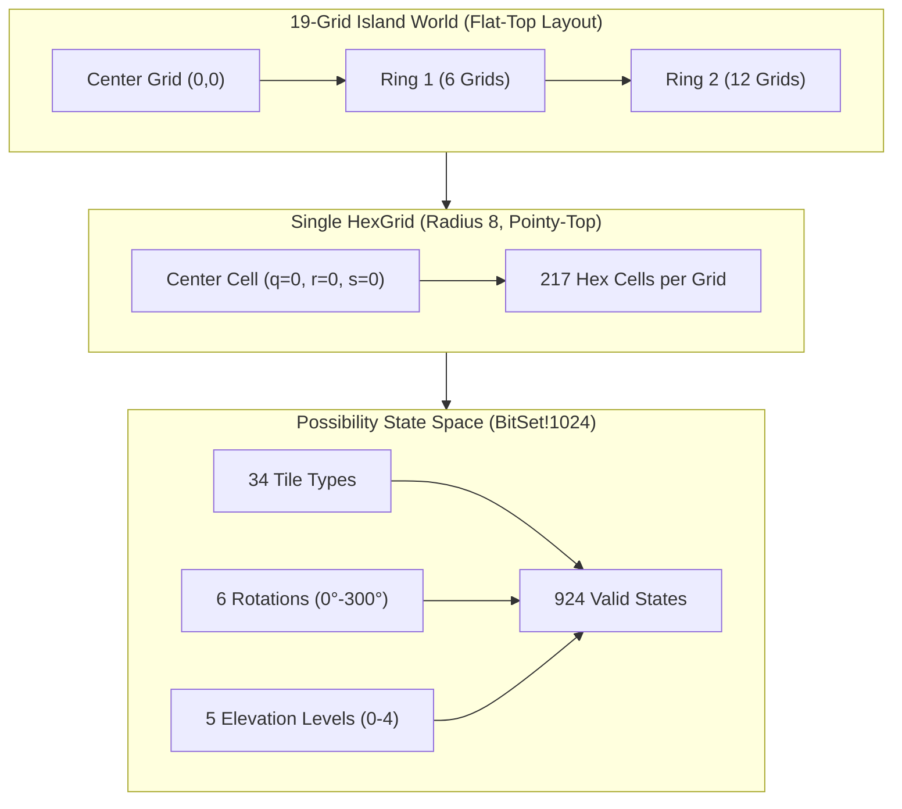
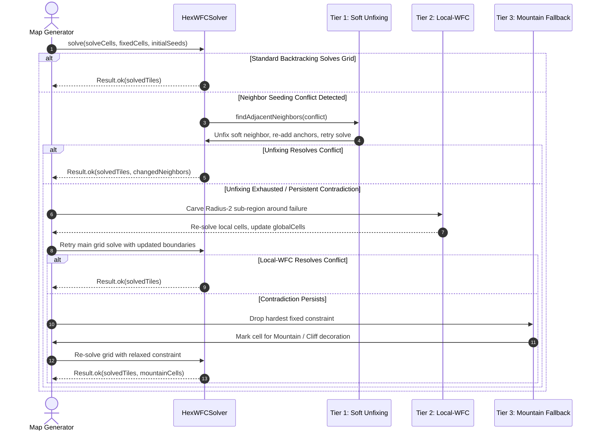

# Hex-Map WFC: JavaScript to Dlang Conversion Roadmap

> **Attribution Preservation Notice**
> 
> The reference implementation in `third-party/Hex-Map-WFC` is created by **Felix Turner**:
> * **Copyright (c) 2026 Felix Turner** (MIT License)
> * Reference Repository: [https://github.com/felixturner/hex-map-wfc](https://github.com/felixturner/hex-map-wfc)
> 
> Upstream Credits:
> * **Kay Lousberg** — [KayKit Medieval Hexagon Pack](https://kaylousberg.itch.io/kaykit-medieval-hexagon) (tile & prop assets)
> * **Maxim Gumin** — [WaveFunctionCollapse](https://github.com/mxgmn/WaveFunctionCollapse) (original WFC algorithm)
> * **Amit Patel / Red Blob Games** — [Hexagonal Grids](https://www.redblobgames.com/grids/hexagons/) (hex coordinate math)
> 
> Every ported Dlang module will include standard copyright attribution headers acknowledging Felix Turner and upstream contributors.

---

## 1. Executive Summary & Architectural Directives

This document details the complete technical roadmap for porting the hexagonal Wave Function Collapse (WFC) island generator from JavaScript to high-performance, druntime-only **Dlang**. The resulting module will serve as the procedural map generation and terrain substrate for the Tower Defense engine.

### Core Architectural Directives (per `AGENTS.md`)
1. **Zero Phobos (`std.*` is strictly prohibited):** The entire codebase must link against `druntime-ldc` only (`-defaultlib=druntime-ldc`). All utilities (random numbers, noise, bitsets, containers, math) are implemented in internal modules or `core.*`.
2. **Exception-Free (`nothrow`):** Code compiles with `-fno-exceptions`. Errors and contradiction states propagate via zero-allocation tagged unions (`Result!(T, E)`) or assertions for invariants.
3. **Zero GC in Hot Paths (`@nogc`):** Grid traversal, entropy tracking, propagation, and backtracking operate without garbage collector allocations, statically verified with `ldc2 -vgc`.
4. **Strict MVC Decoupling:** The simulation and map generation logic (Model) is 100% headless, compiling without SDL3 or GPU dependencies.
5. **Potato-Tier Performance Envelope:** Pre-allocated bitmasks and trail stacks replace JavaScript's dynamic `Set` string allocations, achieving orders-of-magnitude faster solve times with negligible memory footprint.
6. **Layered Recovery for 100% Solve Rate:** Port Felix Turner's 3-tier recovery pipeline (soft neighbor unfixing $\to$ local-WFC mini-solver $\to$ mountain fallback).

---

## 2. Source-to-Target File Mapping & Scope

| Original JS File (`third-party/Hex-Map-WFC/`) | Target Dlang Module (`src/`) | Layer | Responsibility & Porting Strategy |
| :--- | :--- | :--- | :--- |
| `LICENSE` | `LICENSE` / headers | Legal | MIT License & Felix Turner attribution headers on every file. |
| `src/SeededRandom.js` | `src/core/random.d` | Core | Mulberry32 32-bit deterministic PRNG (`@nogc nothrow pure`). |
| *(None - custom)* | `src/core/result.d` | Core | Zero-allocation `Result!(T, E)` tagged union. |
| *(None - custom)* | `src/core/bitset.d` | Core | Pre-allocated `BitSet!1024` (16 `ulong`s = 128 bytes) for state masks. |
| `src/hexmap/DecorationDefs.js` (noise) | `src/core/noise.d` | Core | In-house 2D Simplex noise generator (`@nogc nothrow`). |
| `src/hexmap/HexTileData.js` | `src/wfc/tile_data.d` | Model | 34 tile definitions, 5 elevation levels, edge types, weights, slope metadata. |
| `src/hexmap/HexWFCCore.js` | `src/wfc/hex.d` & `src/wfc/rules.d` | Model | Cube coordinates $(q,r,s)$, odd-r offsets, 3D `byEdge` constraint index table. |
| `src/hexmap/HexGridConnector.js` | `src/wfc/grid_connector.d` | Model | Flat-top odd-q hex grid-of-grids layout, 19-grid island topology, world coordinates. |
| `src/workers/wfc.worker.js` | `src/wfc/solver.d` | Model | `HexWFCSolver`: Shannon/count entropy, trail-based backtracking, chaining pruning. |
| `src/hexmap/WFCManager.js` | `src/wfc/manager.d` | Model | Solver orchestration, global cube coordinate registry, region fixed-cell gathering. |
| `src/hexmap/HexMap.js` (logic) | `src/wfc/map_generator.d` & `recovery.d` | Model | 19-grid multi-grid island generator, ocean seeds, unfixing, local-WFC, mountain fallback. |
| `src/hexmap/Decorations.js` (logic) | `src/wfc/decorations.d` | Model | Procedural noise-based placement for trees, buildings, windmills, and bridges. |
| `tools/tileset-audit.js` | `tests/tileset_audit.d` | Test/Tool | Headless CLI auditing tileset completeness, dead ends, and branch factors. |
| `src/Lighting.js`, `PostFX.js`, `Water.js`, etc. | `src/gfx/*` (Future Phase) | View | Three.js shaders & render pipelines will be adapted into SDL3 2D/GPU in a subsequent task. |

---

## 3. Core Architecture & Mathematical Foundations

### 3.1. Coordinate Systems

The architecture utilizes two distinct hexagonal coordinate systems:
1. **Pointy-Top Hex Cells (Tile Level):**
   - Odd-r offset coordinates for grid arrays: Column `col`, Row `row`.
   - Cube coordinates for rotation-invariant distance and neighbor queries:
     $$q + r + s = 0$$
   - Neighbor direction vectors in order `[NE, E, SE, SW, W, NW]`:
     $$\begin{aligned}
     \text{NE} &= (+1, -1, 0), & \text{E} &= (+1, 0, -1), & \text{SE} &= (0, +1, -1) \\
     \text{SW} &= (-1, +1, 0), & \text{W} &= (-1, 0, +1), & \text{NW} &= (0, -1, +1)
     \end{aligned}$$

2. **Flat-Top Hex Grids (Grid-of-Grids Level):**
   - 19 hexagonal grids arranged in a radius-2 flat-top cluster ($1 + 6 + 12 = 19$ grids).
   - Flat edges at North and South; neighbor directions are `[N, NE, SE, S, SW, NW]`.
   - Odd-q offset layout across grids.



### 3.2. State Space & BitSet Acceleration

In the JavaScript reference, each cell maintained a `Set<string>` of keys like `"15_2_3"`. In Dlang:
* There are 34 tile definitions in `TILE_LIST`.
* 23 standard tiles $\times$ 6 rotations $\times$ 5 levels = 690 states.
* 6 low-slope tiles (rise +1) $\times$ 6 rotations $\times$ 4 base levels (0..3) = 144 states.
* 5 high-slope tiles (rise +2) $\times$ 6 rotations $\times$ 3 base levels (0..2) = 90 states.
* **Total States:** Exactly **924 states**.

A custom `BitSet!1024` stores these 924 states in **16 `ulong`s (128 bytes)**:
```d
struct BitSet1024 {
    ulong[16] words;

    void set(size_t bit) nothrow @nogc pure @safe {
        words[bit >> 6] |= (1UL << (bit & 63));
    }
    void clear(size_t bit) nothrow @nogc pure @safe {
        words[bit >> 6] &= ~(1UL << (bit & 63));
    }
    bool test(size_t bit) const nothrow @nogc pure @safe {
        return (words[bit >> 6] & (1UL << (bit & 63))) != 0;
    }
    void intersect(const ref BitSet1024 rhs) nothrow @nogc pure @safe {
        foreach (i; 0 .. 16) words[i] &= rhs.words[i];
    }
    size_t count() const nothrow @nogc pure @safe {
        import core.bitop : popcnt;
        size_t n = 0;
        foreach (i; 0 .. 16) n += popcnt(words[i]);
        return n;
    }
}
```
**Constraint propagation becomes simple bitwise `intersect` operations**, running entirely in CPU registers/L1 cache with zero memory allocations.

---

## 4. WFC Solver & 3-Tier Layered Recovery Pipeline



### 4.1. Fast Adjacency Lookup Table (`byEdge`)
Adjacency is indexed 3-dimensionally:
`byEdge[EdgeType][HexDir][level] -> BitSet1024`
When cell $A$ collapses or prunes possibilities in direction $D$, the allowed states in neighbor $B$ in return direction $D_{\text{opp}}$ is computed by OR-ing the precomputed bitmasks of all edge types present on $A$'s remaining states.

### 4.2. Trail-Based Backtracking
Instead of copying whole grid states, the solver uses an undo trail:
```d
struct TrailEntry {
    ushort cellIndex;
    ushort stateId;
}
```
When backtracking, each pruned possibility on the trail is re-enabled up to the decision point index, eliminating state cloning.

---

## 5. Detailed Step-by-Step Implementation Phases

### Phase 1: Core Druntime Primitives & Attribution Framework
* [x] Create `src/core/result.d`: Zero-allocation tagged union `Result!(T, E)`.
* [x] Create `src/core/random.d`: Deterministic Mulberry32 32-bit PRNG with `setSeed`, `random`, `uniform01`, `shuffle`.
* [x] Create `src/core/bitset.d`: `BitSet!N` with bitwise ops, `popcnt`, `bsf`, and iteration.
* [x] Create `src/core/noise.d`: 2D Simplex noise generator (`@nogc nothrow`).
* [x] Add unit tests for all core primitives.

### Phase 2: Hex Coordinate Geometry & Math
* [x] Create `src/wfc/hex.d`:
  - `CubeCoord(int q, int r, int s)` with invariant $q + r + s = 0$.
  - Conversion between odd-r offset `(col, row)` and cube coordinates.
  - Neighbor lookups for all 6 pointy-top directions `[NE, E, SE, SW, W, NW]`.
  - Hex distance, range queries (`cubeCoordsInRadius`), and return directions.
* [x] Colocated unit tests verifying coordinate round-tripping and metric invariants.

### Phase 3: Tile Catalog & Adjacency Precomputation
* [x] Create `src/wfc/tile_data.d`:
  - Enums `EdgeType` (`grass`, `water`, `road`, `river`, `coast`) and `HexDir`.
  - Static definition of all 34 tiles from `HexTileData.js`.
  - Slopes, high edges, `levelIncrement` (1 or 2), and `preventChaining` flags.
  - Edge rotation functions (`rotateHexEdges`).
* [x] Create `src/wfc/rules.d`:
  - State enumeration generating all 924 valid `(tileType, rotation, level)` states.
  - Calculation of edge levels: slopes have elevated levels on high edges.
  - `HexWFCAdjacencyRules` table: precomputes `byEdge[edgeType][dir][level]` bitsets.
* [x] Colocated unit tests verifying table symmetry and rule generation.

### Phase 4: Headless WFC Solver with Backtracking
* [x] Create `src/wfc/cell.d`:
  - `HexWFCCell` storing remaining possibilities (`BitSet1024`), collapsed state, and entropy.
* [x] Create `src/wfc/solver.d`:
  - Pre-allocated arrays for cells, neighbors, propagation stack, decision stack, and trail.
  - No-chaining pruning for tiles with `preventChaining = true` (e.g. cross roads, river bends).
  - Entropy search with pseudo-random perturbation for tie-breaking.
  - Constraint propagation loop using bitmask intersections.
  - Backtracking engine with decision stack and undo trail (up to 500 backtracks).
  - Contradiction reporting (`failedCell`, `sourceKey`, `neighborConflict`).

### Phase 5: Multi-Grid Topology & Soft Boundary Unfixing
* [ ] Create `src/wfc/grid_connector.d`:
  - Flat-top hex coordinates for 19-grid cluster.
  - Odd-q offset grid navigation with directions `[N, NE, SE, S, SW, NW]`.
  - Local-to-global and global-to-local grid coordinate conversions.
* [ ] Integrate soft boundary unfixing in `src/wfc/solver.d`:
  - Ingest boundary neighbor cells from adjacent pre-solved grids.
  - Upon neighbor boundary conflict, unfix conflicting neighbor cells, converting them into active solve cells while locking their outer anchors.
  - Re-run solve with flexible boundary.

### Phase 6: Layered Recovery System & Island Orchestration
* [ ] Create `src/wfc/recovery.d`:
  - Local-WFC: Carve radius-2 sub-region around failed coordinates, re-solve locally with relaxed boundary conditions.
  - Drop Phase / Mountain Fallback: Sort unresolvable constraints by proximity to failure, drop constraint, and flag coordinate for mountain/cliff placement.
* [ ] Create `src/wfc/map_generator.d`:
  - Island perimeter ocean seeding (`addWaterEdgeSeeds`, `getMapCornerOceanSeeds`).
  - Sequentially solve all 19 grids, stitching boundaries seamlessly.
  - Global cell map tracking all ~4,123 tiles.

### Phase 7: Procedural Noise & Decoration Placement
* [ ] Create `src/wfc/decorations.d`:
  - Multi-octave Simplex noise sampling for organic clustering.
  - Forest placement on grass tiles exceeding tree noise threshold.
  - Village & windmill placement along road networks.
  - Bridge placement across river crossings.
  - Mountain placement on dropped constraint cells to mask terrain discontinuities.

### Phase 8: Tileset Audit Tool & Headless Integration Tests
* [ ] Create `tests/tileset_audit.d`:
  - Port `tools/tileset-audit.js` to a headless D binary.
  - Audit every `(edgeType, level)` pair across all directions, reporting branching factors and asserting zero unresolvable dead ends.
* [ ] Create `tests/test_wfc_single_grid.d`:
  - Solve single grids across 100 random seeds, verifying 100% solve rate without crashes.
* [ ] Create `tests/test_wfc_multi_grid.d`:
  - Solve complete 19-grid island maps across multiple seeds, verifying seamless tile edge matching across all grid boundaries.
* [ ] Create `tests/test_runner.d`:
  - Central test runner with explicit timeout enforcement and memory monitoring.

### Phase 9: Microbenchmarks & Performance Optimization
* [ ] Create `benchmarks/bench_wfc_solve.d`:
  - Benchmark single-grid solve latency (microseconds per grid) and 19-grid full island generation time.
  - Validate performance on low-spec hardware target budget.
* [ ] Create `benchmarks/bench_propagation.d`:
  - Microbenchmark measuring raw BitSet intersection throughput in hot loop.

### Phase 10: Verification, Formatting, and Sanitizers
* [ ] Verify zero Phobos imports (`grep -rn "import std\." src/`).
* [ ] Verify zero GC allocations in hot paths (`ldc2 -c -vgc -defaultlib=druntime-ldc src/wfc/*.d`).
* [ ] Format all `.d` files using `dfmt`.
* [ ] Run test suite under AddressSanitizer and LeakSanitizer:
  `ldc2 -fsanitize=address -defaultlib=druntime-ldc -fno-exceptions -g -unittest -run tests/test_runner.d`

---

## 6. Verification Checklist & Success Criteria

1. **Compilation Cleanliness:**
   - Compiles cleanly with `ldc2 -defaultlib=druntime-ldc -fno-exceptions -Wall`.
   - Zero compilation warnings.
2. **Zero GC in Hot Loop:**
   - `ldc2 -c -vgc` emits zero lines of output on all simulation modules.
3. **Deterministic Solves:**
   - Identical seeds yield byte-for-byte identical tile layouts across platforms.
4. **100% Solve Rate:**
   - Over 1,000 multi-grid integration test runs, the layered recovery pipeline achieves a 100% solve rate without unsolvable contradictions.
5. **Memory Cleanliness:**
   - Runs cleanly under AddressSanitizer (ASan) and Valgrind Memcheck with zero memory leaks or invalid memory accesses.
